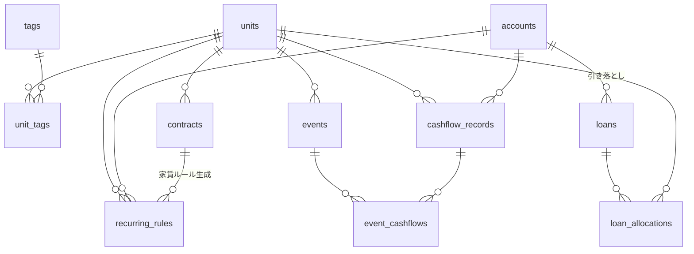

# 不動産の森 by Morincum 引き継ぎ資料

| 項目 | 内容 |
|---|---|
| 対象 | 不動産の森（Fudosan no Mori）の企画・設計 |
| 元にした会話 | 「投資用マンション管理アプリの開発戦略」（2026-08 / 88ターン）、「投資用マンション管理アプリの企画」「初期モック」（2026-03） |
| 成果物 | 仕様書 `fudosan-mori-spec-v0.1.md`（中身はv0.2.4まで改版）、[`fudosan-mori-spec-v0.2.html`](../design/fudosan-mori-spec-v0.2.html)（Mermaid描画版）、[`fudosan-mock-v0.1.jsx`](../design/mock/fudosan-mock-v0.1.jsx) |
| 作成日 | 2026-11-20 |

> 3月の会話では「棟に部屋がぶら下がる階層構造」で考えていましたが、8月の会話で**フラットな部屋（unit）＋タグ**に変えています。この資料は8月時点の決定内容を正としています。
>
> 仕様書の本文は、この specs では章ごとに分けて置いています：[product-plan.md](product-plan.md)（企画・未決事項・変更履歴）、[design-guideline.md](design-guideline.md)、[ui-spec.md](../020.system/ui-spec.md)、[internal-processing.md](../020.system/internal-processing.md)、[frontend-schema.md](../030.database/frontend-schema.md)

---

## 1. コンセプト

| 項目 | 決定内容 | 理由・背景 |
|---|---|---|
| 出発点 | **毎月の合計収支を見たい** | なそさんの実際のニーズ。配当の森とまとめて全部見ることは狙わない |
| 位置づけ | Morincumファミリーの単一目的アプリ（不動産のインカム管理） | 1アプリ1役割。全部入りのアプリとは戦わない |
| 想定ユーザー | 一般公開・個人オーナー向け | 将来はHPでFPと共有しながら話せる形を目指す |
| 動作 | **スマホ内で完結**（ローカルファースト / SQLite） | 株価のような外部データが要らず、日々のAPI取得も不要 |
| 個人情報 | 預からない（サイレントCognito・口座番号も持たない） | 配当の森と同じ思想 |
| 入出金の扱い | **すべて「予定」として表示する** | 残高はアプリの管理外。実際の口座と見比べてもらう前提 |
| データモデル | **ファミリー内で共通化しない（アプリごとに独立）** | 共通スキーマで縛らない。連携が必要になったら月次サマリーを出力して変換する |

## 2. ファミリー全体での位置づけ

```mermaid
flowchart TB
  subgraph 入力系アプリ
    H[配当の森<br/>配当・優待]
    F[不動産の森<br/>家賃・経費・ローン]
    K[家計の森<br/>カード明細CSV]
  end
  subgraph 閲覧系（将来）
    D[統合ダッシュボード]
    W[FP向けWeb]
  end
  ID[(MORINCUM ID<br/>プレミアのみ明示作成)]
  H -. プレミア .-> ID
  F -. プレミア .-> ID
  K -. プレミア .-> ID
  ID --> D
  ID --> W
```

| 項目 | 決定内容 |
|---|---|
| ドメイン | ユーザーが目にするもの（HP・特商法・OTPメール）は `morincum.jp`、アプリ内部の通信（API）は `api.morincum.com` |
| 統合ダッシュボード / FP向けWeb | 将来構想。各アプリは独立のまま、プレミアで連携する |

## 3. 認証・サーバー構成

| 項目 | 決定内容 | 補足 |
|---|---|---|
| 単体利用時のID | アプリが裏で自動作成するCognitoアカウント（ユーザーには見せない） | 配当の森の既存User PoolにApp Clientを1つ追加する |
| MORINCUM ID | **ファミリー連携時だけ、ユーザーが明示的に作る** | 「ログインしている」と見せたくない、というなそさんの意向 |
| ID同士の紐付け | 各アプリのIDは統合せず、マッピングテーブルで紐付ける（提案） | Cognitoではsubを統合できないため |
| 認証方式（連携時） | Email OTP＋Sign in with Apple（メール非公開）を提案 | パスワードを預からない |
| 新しく作るAWSリソース | **なし** | 課金検証（エンタイトルメントAPI）は配当の森と共用 |
| 課金の紐付け | レシート → subに紐付ける（ストアのアカウントには紐付けない） | Google Playの購入はストア側のアカウントに紐づくため |

## 4. プラン構成

価値の軸：**フリー＝記録できる / スタンダード＝経営が見える / プレミア＝つながる**

| 機能 | フリー | スタンダード | プレミア |
|---|:-:|:-:|:-:|
| 物件（unit）数 | 5件まで | 無制限 | 無制限 |
| 収支の記録・物件ごとの月次収支 | ○ | ○ | ○ |
| タグ管理・絞り込み | ○ | ○ | ○ |
| ローン返済額の入力（simple：銀行・口座・引き落とし日・月額） | ○ | ○ | ○ |
| 入出金ビュー（口座別）・月別棒グラフ・年間トータル | ○ | ○ | ○ |
| 引き落とし前日の通知 | ○ | ○ | ○ |
| イベント（トラブル・更新・総会・退去）と収支の紐付け | ○ | ○ | ○ |
| ローン詳細（detailed：残債・利息内訳・手残り） | — | ○ | ○ |
| 分析タブ（タグをまたいだダッシュボード・推移・物件比較） | — | ○ | ○ |
| 年間サマリー（確定申告向け）・CSVエクスポート | — | ○ | ○ |
| 広告 | あり | なし | なし |
| クラウド同期・統合ダッシュボード・FP共有 | — | — | ○ |

| 線引きの原則 | 内容 |
|---|---|
| 無料に置くもの | 日々の資金繰り・事実の集計（入出金・月別棒グラフ・イベント） |
| 有料に置くもの | 物件やタグをまたいだ分析・推移・比較 |
| 物件数の制限 | AWSのコストには影響しないので、純粋に課金設計として決めた |
| 広告の位置づけ | 起動頻度が低く、収益は期待しない。「広告を消す」が課金の理由になる |
| 要検討 | 駐車場を区画ごとに数えると5件にすぐ届く（0.5件カウントなどの緩和が要るか） |

## 5. データモデル（v0.2系）



| テーブル | 役割 | 要点 |
|---|---|---|
| units | 貸し出す単位（部屋・駐車場・その他） | `unit_type`、取得情報は任意（駐車場向け）、専有面積・敷地面積・敷地権割合・管理会社・`assembly_month`（総会月）、`archived_at` |
| tags / unit_tags | グルーピング | system（都道府県・空室・売却済を自動で付与）とuser（一棟名・売却検討など）。v1の複数選択はANDのみ |
| contracts | 賃貸借契約 | 期間・種別（普通/定期借家）・賃料・入金日と入金口座・敷金・礼金・更新料・状態。**空室は「有効な契約がない」ことから判定する** |
| accounts | 口座 | 表示名・銀行名・識別色のみ。**口座番号は持たない** |
| loans / loan_allocations | ローン | `input_mode`（simple/detailed）。一棟ローンは物件ごとに按分する |
| recurring_rules | 定期収支 | 家賃ルールは契約から自動で生成し、契約終了で止める |
| cashflow_records | 収支の明細 | 収入と支出を1テーブルに。カテゴリは確定申告の経費区分に合わせる。将来は `transfer` を足して口座間振替に拡張できる |
| events / event_cashflows | 出来事 | trouble / renewal / meeting / **moveout** / other。経緯は追記型のログ。費用を紐付ける |

| 設計ルール | 内容 |
|---|---|
| 金額 | 整数（円）で持つ |
| ID | UUID（将来のクラウド同期に備える） |
| 派生値 | 利回り・減価償却・手残り・稼働率はDBに持たず、その都度計算する |
| 口座の紐付け | 物件単位ではなく**取引単位**（家賃・ローンはA銀行、管理費・修繕積立金はB銀行、というなそさんの実例に対応） |

## 6. 削除の考え方（3層）

| 層 | 対象 | 挙動 |
|---|---|---|
| 訂正 | 入力ミス（明細） | 実際に削除する。前年以前の記録を消すときは警告を出す |
| アーカイブ | 売却済の物件・完済したローン・解約した口座・使わなくなったタグ | 消さずに非表示にする。履歴と集計には残る |
| 完全削除 | 本当に消したいもの | 設定 › アーカイブの管理からのみ。巻き込んで消えるデータの範囲を明示する |

- 原則：**マスタは消さない、明細は訂正できる**
- ライフサイクルの終わりは「削除」と呼ばない：「売却を記録」「完済を記録」「解約（アーカイブ）」

## 7. 画面構成

**タブバー（ファミリー共通の中央ホーム型）**：入出金・イベント ｜（中央の丸ボタン）ホーム ｜ 分析・設定

| ID | 画面 | 要点 |
|---|---|---|
| S-01 | ホーム | タグバー、手残りサマリー、近づく期日、物件カード（空室・P駐車場・🏛◯月総会のバッジ）、末尾に「＋物件を追加」カード（上限に達したらスタンダードへ誘導） |
| — | 入出金 | 年間トータル＋月別棒グラフ（**口座ごとに色分けして積み上げ**。左＝入金、右＝出金、将来の月は薄い色）。月をタップすると明細が切り替わる。明細は銀行ごと/日付ごと（設定で切替）。「予定」であることを明記 |
| — | イベント | 対応中/解決済。開くと経緯ログと費用の累計が見える |
| S-19 | 分析 | スタンダード機能。フリーではロックしたプレビューを見せる |
| S-04 | 設定 | **配当の森 v1.1.3と同じ型**：契約状態 → 表示 → 通知 → データ → データ管理 → セキュリティ（PINロック） → 利用規約 → 注意事項（サブスクの返金・解約を含む） → ロゴ |
| S-05 | 物件詳細 | セクションカードを並べ、この物件に関するすべての入口にする（基本情報・契約・ローン・定期支出・評価額・イベント・売却/アーカイブ） |
| S-06 | 収支記録 | ポップアップ |
| S-07 | 物件登録ウィザード | **最低3問**（名称／家賃と入金日／返済額と引き落とし日）。**画面モックはまだない** |
| S-14〜S-18 | 物件情報・契約・ローン・定期ルール・評価額の編集 | 物件詳細から遷移する専用画面 |

### 入力場所の3層ルール

| 層 | 対象 | 基準 |
|---|---|---|
| ポップアップ | 収支記録・経緯の追記・月次の確認 | 回数が多く、1分以内に終わるもの |
| 専用画面（物件詳細から入る） | 物件情報・契約・ローン・定期支出・評価額 | 回数が少なく、構造的なもの |
| 設定タブ | 口座・タグ・通知・表示・プラン・アーカイブ | アプリ全体に関わるものだけ。**物件固有の項目は置かない** |

## 8. 通知

| 種類 | タイミング |
|---|---|
| 引き落とし前日 | 前日の18:00（文言は必ず「〜の引き落とし**予定**」） |
| 契約満了 | 満了の3ヶ月前に更新イベントの作成を提案 |
| 総会シーズン | 総会月の前月にイベントの作成を提案（P-18） |
| イベント期日 | 期日の前 |
| 月初の家賃入金確認 | 任意（既定はOFF） |

※ 配当の森ではPUSH通知を使っていないので、技術検証も兼ねる。

## 9. デザイン

| 項目 | 内容 |
|---|---|
| ベース | 配当の森のデザイン体系（theme変数・影・構造）に厳密に合わせる |
| 色 | ファミリー共通の緑＝入金・プラス / テラコッタ `#A8552F`＝このアプリのアクセント・出金 |
| 口座の識別色 | 例：みずほ＝青、北洋＝アンバー（自動で割り当てるかユーザーが選ぶかは未定） |
| ロゴ | 加工せずに使う |
| `@morincum/ui` 候補 | CenterTabBar、SettingsLayout / ActionRow、金額表示、月次チャート、CSVインポートUI |

## 10. 未決事項・申し送り

| # | 項目 | 状況 |
|---|---|---|
| 1 | 敷金の預り金管理 | v1では退去精算の差額だけを記録し、預り金の管理はv1.xで |
| 2 | 定期借家の再契約フロー | v1.xで詳細化 |
| 3 | 評価額ウィザード | v1.xは基本式＋貸家建付地まで。区分所有の補正率は対象外 |
| 4 | 口座間振替 | `direction=transfer` でv1.xに拡張 |
| 5 | 複数の物件にまたがる経費の按分支援 | v1.x（v1では代表の物件に入れるか、手で分ける） |
| 6 | 言語設定 | v1は日本語のみで良いか判断が必要 |
| 7 | 年間手残り目標 | v1.x候補（配当の森の目標設定に相当） |
| 8 | 配当の森への反映 | 注意事項に「サブスクリプションについて（返金・解約）」を追加する（v1.1系） |
| 9 | 駐車場の件数カウント | 5件の制限を緩和するかどうか |
| 10 | 過去の月の「確定」フロー | 月次の確認（儀式）で、実績と未確認をどう表示し分けるか |
| 11 | 消費税区分 | 駐車場収入は課税売上になりうる。年間サマリーで区分表示するかどうか |
| 12 | モックのボタンが押せない不具合 | **2026-11-20 調査済み**。レイアウトの不具合（透明な要素の重なりなど）ではなく、`onClick` が付いていない（または空の）ボタンが多いことが原因。下の表を参照。モック第2弾で各画面につなげる |

### #12 の調査結果：押しても反応しないもの（mock v0.1）

| 画面 | 押しても反応しないもの |
|---|---|
| ホーム | 「＋物件を追加」カード、タグの「＋」 |
| 物件詳細 | 「編集 ›」すべて、「契約を終了（退去を記録）」「＋新しい契約」「路線価から計算」 |
| イベント | 「経緯を追記」「収支を紐付け」「解決済にする」 |
| 分析・設定 | アップグレードのボタン、「購入の復元」、通知のトグル、各行のボタン |

動くもの：タブ、タグの絞り込み、物件カード → 物件詳細、月の棒グラフと◀▶、イベントの開閉、FAB（＋）→ 収支記録ポップアップ、設定の明細表示の切り替え。

## 11. 次のアクション

| # | 内容 | 状況 |
|---|---|---|
| 1 | モックのボタン不具合が直っているか確認する | 調査済み（上の #12） |
| 2 | モック第2弾：S-07登録ウィザード、S-14〜S-18の編集画面 | 未着手 |
| 3 | 仕様書を `Morincum-specs` に登録する（正本として） | Specs #105 で登録 |
| 4 | Issueに分解し、アプリのリポジトリを立ち上げる | リポジトリは作成済み（[`Morincum-fudosan`](https://github.com/satouhiroyuki/Morincum-fudosan)、まだ空）。Issue への分解は未着手 |
