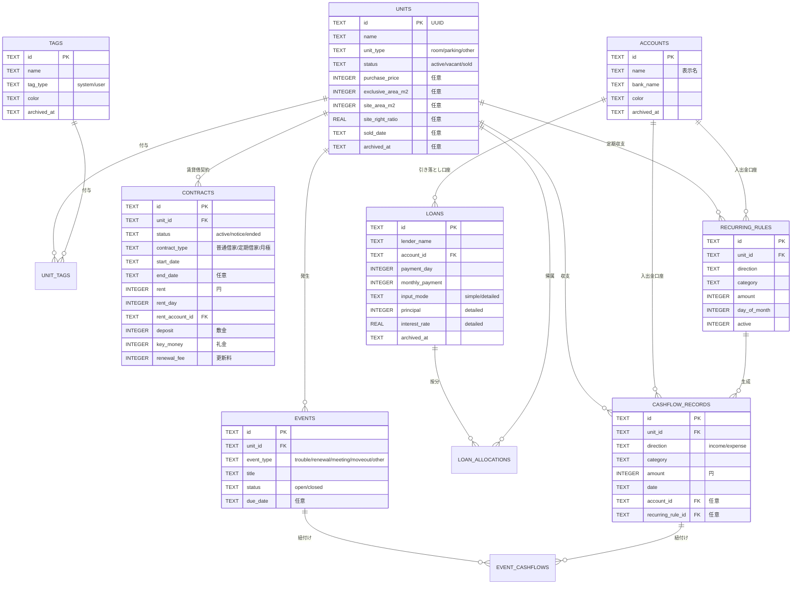

# 不動産の森 by Morincum — 端末内データモデル（SQLite）

> ソース: 仕様書 `fudosan-mori-spec-v0.1.md`（v0.2.4、Mermaid描画版 `fudosan-mori-spec-v0.2.html`）を章ごとに分けて Markdown にしたもの
> UIの正: [`design/mock/fudosan-mock-v0.1.jsx`](../design/mock/fudosan-mock-v0.1.jsx)
> 状態: モック検証中（実装未着手）。判断の経緯は [handoff-2026-11-20.md](../010.product/handoff-2026-11-20.md) を参照

## 4. ER図

---

## 5. テーブル定義

- ストレージ: 端末内SQLite(expo-sqlite)
- 主キーはすべて**アプリ生成のUUID(TEXT)**。プレミアのクラウド同期時に衝突なくアップロードするため
- 金額はすべて**整数(円)**。浮動小数は使用しない
- 日付・日時はISO 8601文字列(TEXT)
- 削除の3層モデル: **訂正**(明細のハード削除)/**アーカイブ**(`archived_at`)/**完全削除**(S-11のみ、連鎖明示)

### 5.1 units(貸出単位)

「賃料が発生する貸出単位」。部屋・駐車場区画・その他を同一構造で扱う。**v0.2で家賃・契約関連(rent/rent_day/rent_account_id/contract_end_date)はcontracts(5.5)へ移管**。空室は「有効な契約の有無」から導出する。

| カラム | 型 | 制約 | 説明 |
|---|---|---|---|
| id | TEXT | PK | UUID |
| name | TEXT | NOT NULL | 表示名(例: パークサイド代々木 402) |
| unit_type | TEXT | NOT NULL DEFAULT 'room' | room / parking / other。将来の消費税区分(駐車場=課税売上)の基礎 |
| status | TEXT | NOT NULL DEFAULT 'active' | active(運用中)/ sold(売却済)。※空室はstatusでなく有効契約の有無から導出 |
| purchase_date | TEXT |  | 取得日(任意) |
| purchase_price | INTEGER |  | 取得価格(任意。駐車場等はNULL可。NULL時は利回り非表示) |
| acquisition_costs | INTEGER |  | 取得諸費用(任意) |
| building_ratio | INTEGER |  | 建物割合%(減価償却の導出用) |
| building_structure | TEXT |  | RC / S / 木造 等(法定耐用年数の導出用) |
| built_year | INTEGER |  | 築年 |
| current_valuation | INTEGER |  | 現在評価額(任意・参考)。S-18評価額ウィザードの出力先 |
| exclusive_area_m2 | REAL |  | 専有面積(任意) |
| site_area_m2 | REAL |  | 敷地全体面積(任意・路線価評価用) |
| site_right_ratio | REAL |  | 敷地権割合(任意・路線価評価用。例: 0.0123) |
| management_company | TEXT |  | 管理会社名・連絡先メモ(任意) |
| assembly_month | INTEGER |  | 管理組合総会の開催月(1-12・任意)。ホームのカードにバッジ表示、前月に総会イベント作成を提案(P-18) |
| sold_date | TEXT |  | 売却日(「売却を記録」で設定) |
| sold_price | INTEGER |  | 売却額 |
| note | TEXT |  | 備考 |
| archived_at | TEXT |  | アーカイブ日時(NULL=現役) |
| created_at / updated_at | TEXT | NOT NULL |  |

### 5.2 tags / unit_tags

| tags | 型 | 制約 | 説明 |
|---|---|---|---|
| id | TEXT | PK | UUID |
| name | TEXT | NOT NULL UNIQUE |  |
| tag_type | TEXT | NOT NULL | system(都道府県・空室・売却済等の自動付与)/ user(手動) |
| color | TEXT |  | 表示色 |
| sort_order | INTEGER |  |  |
| archived_at | TEXT |  |  |

| unit_tags | 型 | 制約 |
|---|---|---|
| unit_id | TEXT | FK→units, PK(複合) |
| tag_id | TEXT | FK→tags, PK(複合) |

### 5.3 accounts(口座)

口座番号・支店等は**保持しない**(個人情報最小化)。

| カラム | 型 | 制約 | 説明 |
|---|---|---|---|
| id | TEXT | PK | UUID |
| name | TEXT | NOT NULL | 表示名(例: みずほ 不動産用) |
| bank_name | TEXT |  | 銀行名 |
| color | TEXT | NOT NULL | グラフ・明細の識別色(自動割当+変更可) |
| memo | TEXT |  |  |
| sort_order | INTEGER |  |  |
| archived_at | TEXT |  | 解約時はアーカイブ(過去明細の参照を守る) |
| created_at | TEXT | NOT NULL |  |

### 5.4 loans / loan_allocations

2段階入力: **simple**(フリー: 銀行・口座・引き落とし日・月額の4項目)/**detailed**(スタンダード: +元本・金利・期間で残債/利息内訳/手残り分析を解放)。同一レコードの項目追記で昇格し、データ入れ直しを発生させない。

| loans | 型 | 制約 | 説明 |
|---|---|---|---|
| id | TEXT | PK | UUID |
| lender_name | TEXT | NOT NULL | 借入銀行 |
| account_id | TEXT | FK→accounts | 引き落とし口座 |
| payment_day | INTEGER | NOT NULL | 引き落とし日 |
| monthly_payment | INTEGER | NOT NULL | 月々の返済額(simpleは入力値/detailedは算出キャッシュ) |
| input_mode | TEXT | NOT NULL DEFAULT 'simple' | simple / detailed |
| principal | INTEGER |  | 借入額(detailed) |
| interest_rate | REAL |  | 年利%(detailed) |
| rate_type | TEXT |  | fixed / variable(detailed) |
| term_months | INTEGER |  | 期間(detailed) |
| start_date | TEXT |  | 返済開始(detailed) |
| repayment_method | TEXT |  | annuity(元利均等)/ principal_equal(元金均等) |
| note | TEXT |  |  |
| archived_at | TEXT |  | 完済時は「完済を記録」でアーカイブ |
| created_at / updated_at | TEXT | NOT NULL |  |

返済予定表はテーブルに保存せず都度計算(P-06)。金利改定履歴(loan_rate_changes)はv1.x候補。

| loan_allocations | 型 | 制約 | 説明 |
|---|---|---|---|
| loan_id | TEXT | FK→loans, PK(複合) |  |
| unit_id | TEXT | FK→units, PK(複合) |  |
| allocation_ratio | REAL | NOT NULL DEFAULT 1.0 | 按分率(合計1.0)。区分1戸=1.0の1行。一棟ローンは複数行(既定=戸数均等、変更可) |

### 5.5 contracts(賃貸借契約)【v0.2新設】

入居状況・契約期間を独立エンティティで管理する。「入居中/空室」はunitの手動ステータスではなく**有効契約の有無から自動導出**し、契約履歴から空室期間・稼働率・更新率を正確に算出できる。

| カラム | 型 | 制約 | 説明 |
|---|---|---|---|
| id | TEXT | PK | UUID |
| unit_id | TEXT | FK→units NOT NULL |  |
| status | TEXT | NOT NULL DEFAULT 'active' | active(契約中)/ notice(退去予告受領)/ ended(終了) |
| contract_type | TEXT | NOT NULL | ordinary(普通借家)/ fixed_term(定期借家)/ monthly(月極・駐車場等) |
| start_date | TEXT | NOT NULL | 契約開始日 |
| end_date | TEXT |  | 満了日(月極等の期限なしはNULL)。更新通知(P-13)の起点 |
| rent | INTEGER | NOT NULL | 月額賃料(円) |
| common_fee | INTEGER |  | 共益費(任意・賃料と分ける場合) |
| rent_day | INTEGER | NOT NULL | 入金日 |
| rent_account_id | TEXT | FK→accounts | 入金口座 |
| deposit | INTEGER |  | 敷金(**預り金**。収入ではない。v1は退去精算の差額のみ収支記録) |
| key_money | INTEGER |  | 礼金(収入。契約開始時にcashflow_records生成を提案) |
| renewal_fee | INTEGER |  | 更新料(収入。更新時に生成を提案) |
| guarantor_company | TEXT |  | 保証会社(任意) |
| tenant_memo | TEXT |  | 入居者メモ。個人情報最小化のため氏名等は必須にしない(「2階の法人契約」程度の識別を推奨) |
| notice_date | TEXT |  | 退去予告受領日 |
| ended_date | TEXT |  | 実際の退去日 |
| created_at / updated_at | TEXT | NOT NULL |  |

- 契約開始→家賃の定期ルール(recurring_rules)を自動生成。契約終了→ルール停止(=家賃生成が止まり空室の収支が自然に表現される)
- 「契約を終了」操作は退去イベント(moveout)を自動生成する(P-15)
- 定期借家は更新ではなく再契約(新しい契約レコード)として扱う

### 5.6 cashflow_records(収支記録)

収入・支出を1テーブルで保持。

| カラム | 型 | 制約 | 説明 |
|---|---|---|---|
| id | TEXT | PK | UUID |
| unit_id | TEXT | FK→units NOT NULL |  |
| direction | TEXT | NOT NULL | income / expense(v1.xでtransfer追加予定) |
| category | TEXT | NOT NULL | カテゴリマスタ参照(プリセット+ユーザー追加) |
| amount | INTEGER | NOT NULL | 円 |
| date | TEXT | NOT NULL | 発生日 |
| account_id | TEXT | FK→accounts | 任意 |
| recurring_rule_id | TEXT | FK→recurring_rules | 定期生成分の親(任意) |
| memo | TEXT |  |  |
| created_at | TEXT | NOT NULL |  |

削除ガード: 前年以前の記録の削除時は「{年}の記録です。年間サマリー(申告資料)に影響します」と警告(禁止はしない)。

### 5.7 recurring_rules(定期収支ルール)

| カラム | 型 | 制約 | 説明 |
|---|---|---|---|
| id | TEXT | PK | UUID |
| unit_id | TEXT | FK→units NOT NULL |  |
| direction | TEXT | NOT NULL | income / expense |
| category | TEXT | NOT NULL | 例: 家賃、管理費、修繕積立金 |
| amount | INTEGER | NOT NULL |  |
| account_id | TEXT | FK→accounts |  |
| day_of_month | INTEGER | NOT NULL |  |
| start_month | TEXT | NOT NULL | YYYY-MM |
| end_month | TEXT |  | 任意 |
| active | INTEGER | NOT NULL DEFAULT 1 | 家賃ルールは契約(contracts)から自動生成され、契約終了で停止→空室率の算出根拠 |
| created_at | TEXT | NOT NULL |  |

### 5.8 events / event_cashflows

| events | 型 | 制約 | 説明 |
|---|---|---|---|
| id | TEXT | PK | UUID |
| unit_id | TEXT | FK→units | 一棟全体の出来事は代表unitに紐付け(v1割り切り) |
| event_type | TEXT | NOT NULL | trouble / renewal / meeting / **moveout(退去)** / other |
| title | TEXT | NOT NULL |  |
| status | TEXT | NOT NULL DEFAULT 'open' | open / closed |
| occurred_date | TEXT | NOT NULL | 発生日 |
| due_date | TEXT |  | 対応期限・開催日(通知P-03の対象) |
| log | TEXT | NOT NULL DEFAULT '[]' | 追記型の経緯ログ(JSON配列: {date, text})。保険請求・売却時の修繕履歴説明に転用可 |
| note | TEXT |  |  |
| closed_at | TEXT |  |  |
| created_at / updated_at | TEXT | NOT NULL |  |

| event_cashflows | 型 | 制約 |
|---|---|---|
| event_id | TEXT | FK→events, PK(複合) |
| cashflow_record_id | TEXT | FK→cashflow_records, PK(複合) |

退去イベント(moveout)は原状回復費・クリーニング・鍵交換・敷金精算(差額)・募集費用(AD/仲介手数料)のチェックリストをテンプレートとして持ち、各項目の支出をポップアップ(S-06)で記録して紐付ける。

双方向の価値: イベント→費用累計(このトラブルにいくらかかったか)/収支→文脈(この修繕費は何だったか)。

### 5.9 app_settings(アプリ設定)

| カラム | 型 | 説明 |
|---|---|---|
| key | TEXT PK | 例: flow_grouping(bank/date)、notification_*(トグル) |
| value | TEXT | JSON可 |

### 5.10 サーバー側(共用・参照のみ)

本アプリ専用のサーバーDBは持たない。エンタイトルメントAPI(配当の森と共用)に以下のみ記録される: サイレントアカウントのsub ⇔ プラン状態(レシート検証結果)。

